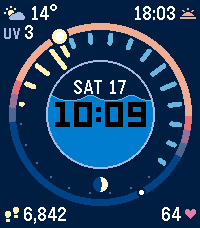
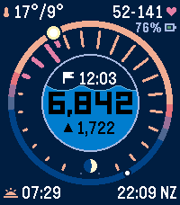

# Meridian

A standalone Pebble Time 2 watchface: a 24-hour sky ring, a sun hand, and a
porthole that fills as you walk. Time and date invert beneath the water.
Steps trail behind the sun; forecast rain sits ahead, including tomorrow.
Tap the display or flick your wrist for the heart/temperature and pace view;
it returns after eight seconds or another tap/flick.

 

Built from Watchface Lab 39 Meridian v2. Its geometry, palette and normal fonts
are preserved. The daytime main face matches the original demo pixel for pixel.
Production changes: rolling rain/temperature across midnight, tomorrow's sunrise,
peak UV in lavender at night, explicit up/down pace, units, partial HR history,
separate simultaneous status rows and correct current-hour goal interpolation.

## Build and install

```sh
git submodule update --init shared-kit
npm ci
pebble build
pebble install --emulator emery
# To install on your paired physical watch:
pebble install --cloudpebble
```

Output: `build/pebble-meridian.pbw`. Emery is the exclusive target. The default
build uses live data (scenario 3), minute ticks and no animation.
The app has its own UUID and phone settings namespace; it shares no runtime
with another face. Its kit dependency follows Mondrian and Underground's Git
submodule/symlink arrangement. See [KIT.md](KIT.md).

The Clay settings expose watch/default or 12/24-hour time, Celsius/Fahrenheit,
step goal (10,000 default), NZ/UTC/LON/NYC/LA/TKY/SYD world time, weather on/off,
and optional health demo fallback (off by default). Weather requires a paired
phone, location permission and internet. The watch schedules half-hour refreshes,
with the shared 45-second watchdog, 1/5/15-minute retries and three-hour atomic
cache expiry. Today-indexed weather remains available alongside the rolling
next-24-hour forecast, tomorrow's sun events and daily peak UV.

## Visuals and verification

```sh
python3 tests/run.py
python3 tools/render_scenes.py
python3 tools/create_assets.py
```

The 47 host scenes cover demo/stress/empty, both views, 12-hour time, midnight,
01:00 with five-digit steps, sunset, both units and wide ranges, absent health
and weather, partial HR, low/charging/offline combinations, all seven weather
kinds, pace ahead/behind/equal, full goals and short forecast caches.
`shots/coverage.png` shows them; `shots/coverage.json` records assertions.
The original demo is pixel-identical; remaining prototype differences are
limited to the requested forecast/UV/pace/status regions. Face and detail
half-resolution glance renders are in `shots/*_glance.png`.

Shared tests cover weather validation, atomic cache/expiry, schedule/retries,
serialized phone messaging, health permission loss, current and recorded-minute
HR, history gaps and 143,192 independent time-zone comparisons. Consumer checks
verify the settings namespace/schema and wire keys; a production calculation
test checks the partial-hour goal time.

Final QEMU evidence lives in `shots/emulator-*.png`, `shots/emulator.log` and
`shots/emulator-results.json`. The test verifies the actual Meridian UUID,
injects synthetic health and a correlated weather reply through real services,
applies live Clay settings, checks persistence after restart, captures detail
and timeout, and exercises charging/low battery/phone loss. The original SDK
profile is preserved and restored; QEMU is stopped afterwards.

Physical-watch
sensor accuracy, retention, touch battery cost and draw timing require Liam's
Time 2. QEMU uses synthetic data and does not establish those measurements.
If a physical frame exceeds about 100 ms, cache the static background/ring
(~45.6 KB) and invalidate it on weather/sun changes. The existing shell logs
face/detail milliseconds for that measurement.

## Design notes

The 24-hour ring has one position per clock hour, so tomorrow's forecast shares
positions with past history. Forecast draws first and history stays on top.
Some rain can be obscured by a longer step ray; a repeated DST hour uses the
first upcoming observation. Slots 23 and 0 retain the moon's breathing space.
The main face shows the next sun event; the detail retains the prototype's
alternate event. The date deliberately omits the month, as the approved design does.

Most values remain Gothic 24 bold. Exceptional wide detail ranges use Gothic 18
bold (11-pixel digits), so they fit without colliding. A star after HR range
means history is incomplete/loading, rather than an abnormal reading. Status
appears on the main face only for phone loss, charging or battery below 20%.

## Store artifacts

`store/face.png`, `store/detail.png`, both icon sizes and `store/description.txt`
are prepared. The initial public release is version 1.0.1.
`npm run release -- --pinned --render` runs the same tested release workflow as
the sibling faces. Ordinary builds never fetch the kit;
the default release command updates it from main and records provenance.

## Final verification — 22 October 2026

The final clean live build completed without warnings. App RAM footprint is
23,594 bytes, leaving 107,478 bytes for heap; bundled resources are 11,006 bytes.
All 47 render scenes and the unchanged-pixel audit passed. The shared regression
suite, Meridian configuration checks and production goal-time checks passed.

The final clean-profile Emery run verified the active UUID, synthetic current
HR and recorded history, correlated 48-hour weather delivery, live Clay 12-hour/
Fahrenheit settings, the eight-second detail return and second-flick toggle,
cache/settings after restart, 5% battery, 62% charging and phone loss/recovery.
Pixel assertions confirm these outcomes. Frames were 2–11 ms, with no timing
underflows or app faults in that final run. A relaunch exit reported zero
remaining app allocations. No bitmap cache was needed for these QEMU timings.
Physical-watch timing and touch power remain unmeasured.

The SDK profile was restored and QEMU stopped. The final artifact and explicit
release provenance receipt are `build/pebble-meridian.pbw` and
`build/pebble-meridian.provenance.json`. The release receipt binds the artifact to the app commit and shared kit revision.
